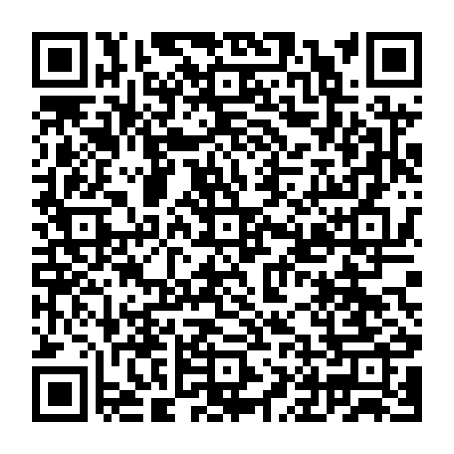

# Glimmerpiece – Android

[Ladda ner Glimmerpiece 1.5.0 direkt](https://raw.githubusercontent.com/MangeMutt/stjarnnyckeln-downloads/main/Glimmerpiece-1.5.0.apk)

Tidigare namn: Stjärnnyckeln. Öppna länken på Android-telefonen, öppna APK-filen och välj Installera eller Uppdatera. Behåll den befintliga appen installerad för att spara framstegen.

## Nytt i 1.5.0

- Större illustration och knappar i listform i huvudmenyn, med nya ikoner och rundare knapptext.
- Klassiska pusselbitar med rundade knoppar för 16, 32 och 64 bitar.
- Coloring-knapp med Coming Soon. Färgläggningsläget kommer senare.

42 bilder, föremålsläge och pusselläge. Fungerar offline. Android 11 eller senare.

SHA-256: `3E38C1AF48191B318A6D916238B84F6395C420FD8619640E413E5CEB74DAA4A2`

[Äldre version 1.4.0](https://raw.githubusercontent.com/MangeMutt/stjarnnyckeln-downloads/main/Stjarnnyckeln-1.4.0.apk) · [Äldre version 1.2.0](https://raw.githubusercontent.com/MangeMutt/stjarnnyckeln-downloads/main/Stjarnnyckeln-1.2.0.apk)

Detta projekt innehåller färdiga installationsfiler och QR-koder. Källkoden hanteras separat.
